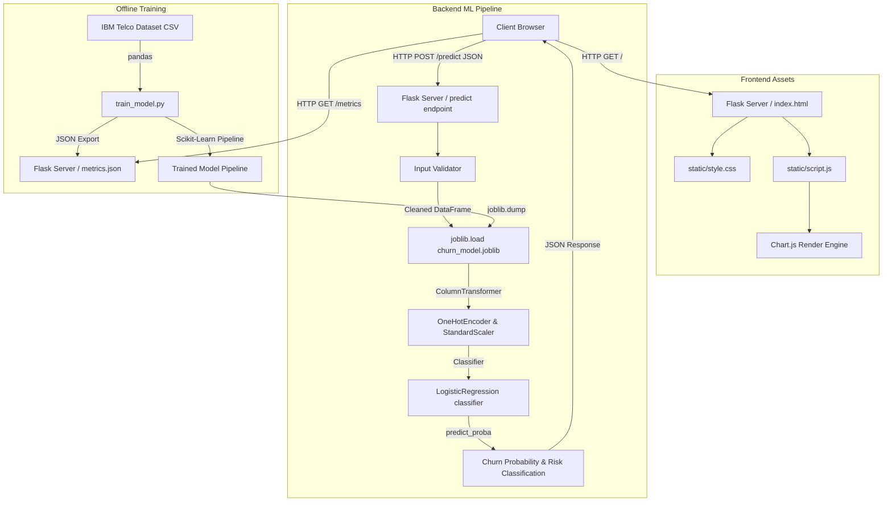

# ChurnGuard — Comprehensive Engineering Specification & Architecture Manual
**Document Version:** 1.0.0  
**Target Environment:** Vercel Serverless & GitHub Integration  
**Core Technologies:** Python, Flask, Scikit-Learn, Joblib, Pandas, NumPy, HTML5, Vanilla CSS3, Javascript, Chart.js

---

## 1. Executive Summary & Project Goal
ChurnGuard is an enterprise-grade customer retention analytics platform designed to predict customer churn using machine learning. The core system trains a logistic regression model on historical customer telemetry data, serializes the trained pipeline, and exposes it through a lightweight Flask REST API and a glassmorphic dark-theme analytics dashboard. 

The primary business goals of ChurnGuard are:
- **Proactive Retention**: Identify high-risk customers based on service profiles, billing behaviors, and contracts before they churn.
- **Explainable Predictions**: Render visual risk meters and highlight critical demographic and operational features that contribute to the customer's churn probability.
- **Serverless Scaling**: Deploy the model using Vercel’s serverless functions to guarantee zero-cold-start mitigation and highly cost-efficient request-driven computing.

---

## 2. High-Level System Architecture
The application follows a decoupled model-view-controller paradigm adapted for serverless machine learning APIs.



---

## 3. Complete Directory Structure
```text
ChurnGaurd/
│
├── .git/                      # Git repository database
├── .gitignore                 # Exclusion patterns for Version Control
├── .python-version            # Specifies Python 3.14 runtime for Vercel
├── vercel.json                # Vercel deployment and routing configuration
├── requirements.txt           # Production python dependencies
├── README.md                  # Public overview and screenshot guide
├── ENGINEERING_SPEC.md        # Technical specification document (this file)
│
├── app.py                     # Flask web server & predictive API router
├── train_model.py             # Machine learning model training pipeline
│
├── data/                      # Dataset repository
│   └── WA_Fn-UseC_-Telco-Customer-Churn.csv  # IBM Telco customer dataset
│
├── model/                     # Trained machine learning artifacts
│   ├── churn_model.joblib     # Serialized Scikit-Learn pipeline
│   └── metrics.json           # Evaluation metrics and dataset statistics
│
├── templates/                 # HTML templates
│   └── index.html             # Premium glassmorphic interface
│
└── static/                    # Frontend assets
    ├── style.css              # Custom dashboard stylesheets
    ├── script.js              # Application logic and Chart.js controller
    └── screenshots/           # UI screenshots for README documentation
        ├── homepage.png
        └── prediction.png
```

---

## 4. Dataset Specification
ChurnGuard operates on the standard **IBM Telco Customer Churn** dataset. The dataset includes operational telemetry for 7,043 telecommunications customers in California.

### 4.1 Feature Set Definitions
The machine learning pipeline consumes a subset of 18 features (15 categorical, 3 numerical) from the dataset.

#### Categorical Features (15 variables):
1. **Senior Citizen**: Indicates if the customer is 65 years or older (`"No"`, `"Yes"`).
2. **Partner**: Indicates if the customer has a partner (`"No"`, `"Yes"`).
3. **Dependents**: Indicates if the customer has dependents (`"No"`, `"Yes"`).
4. **Phone Service**: Indicates if the customer has a home phone service (`"No"`, `"Yes"`).
5. **Multiple Lines**: Indicates if the customer has multiple lines (`"No"`, `"Yes"`, `"No phone service"`).
6. **Internet Service**: Customer’s internet service provider (`"DSL"`, `"Fiber optic"`, `"No"`).
7. **Online Security**: Indicates if the customer has online security (`"No"`, `"Yes"`, `"No internet service"`).
8. **Online Backup**: Indicates if the customer has online backup (`"No"`, `"Yes"`, `"No internet service"`).
9. **Device Protection**: Indicates if the customer has device protection (`"No"`, `"Yes"`, `"No internet service"`).
10. **Tech Support**: Indicates if the customer has tech support (`"No"`, `"Yes"`, `"No internet service"`).
11. **Streaming TV**: Indicates if the customer has streaming TV (`"No"`, `"Yes"`, `"No internet service"`).
12. **Streaming Movies**: Indicates if the customer has streaming movies (`"No"`, `"Yes"`, `"No internet service"`).
13. **Contract**: The contract term of the customer (`"Month-to-month"`, `"One year"`, `"Two year"`).
14. **Paperless Billing**: Indicates if the customer uses paperless billing (`"No"`, `"Yes"`).
15. **Payment Method**: The customer’s billing method (`"Electronic check"`, `"Mailed check"`, `"Bank transfer (automatic)"`, `"Credit card (automatic)"`).

#### Numerical Features (3 variables):
16. **Tenure Months**: Number of months the customer has stayed with the company (`0` to `120` months).
17. **Monthly Charges**: The amount charged to the customer monthly (`0` to `200` USD).
18. **Total Charges**: The total amount charged to the customer (`0` to `10000` USD).

### 4.2 Data Types & Cleaning Constraints
- **NaN Handling**: In the raw dataset, `Total Charges` contains empty string characters for customers with a tenure of 0 months. The training pipeline explicitly coerces these values to numeric types via `pd.to_numeric(..., errors="coerce")` and drops rows with missing values (amounting to 11 rows dropped, resulting in a training dataset size of 7,032 rows).
- **Categorical Integrity**: The Flask server validates incoming request payloads against a pre-defined schema to ensure all categorical features match valid categories. Payloads violating these rules are rejected with an HTTP 422 error.

---

## 5. Machine Learning Pipeline Architecture
To avoid training data leakage and guarantee that preprocessing transformations match the validation dataset exactly, we build a Scikit-Learn `Pipeline`.

```text
Input DataFrame
   │
   ├── [Categorical Features] ──> OneHotEncoder(handle_unknown="ignore") ──┐
   │                                                                       ├──> ColumnTransformer
   └── [Numerical Features]   ──> StandardScaler()                       ──┘
                                                                           │
                                                                           v
                                                                 LogisticRegression()
                                                                           │
                                                                           v
                                                                    Serialized Model
```

### 5.1 Preprocessing Transformations
- **`OneHotEncoder`**: Converts the 15 categorical features into binary indicator variables. To handle values not seen during training, we configure `handle_unknown="ignore"`.
- **`StandardScaler`**: Scales the 3 numerical features to have a mean of 0 and variance of 1:
  $$z = \frac{x - \mu}{\sigma}$$
  This step is critical for Logistic Regression to ensure coefficients are comparable and regularization is applied uniformly across features.

### 5.2 Model Selection and Hyperparameters
- **Algorithm**: Logistic Regression. It outputs stable probability scores using the sigmoid function:
  $$P(Y=1|X) = \frac{1}{1 + e^{-(\beta_0 + \sum \beta_i X_i)}}$$
- **`class_weight="balanced"`**: The dataset contains a high class imbalance (approximately 73% non-churn vs 27% churn). Setting class weights to `"balanced"` automatically adjusts weights inversely proportional to class frequencies:
  $$W_c = \frac{N_{\text{samples}}}{N_{\text{classes}} \times N_c}$$
  This configuration prevents the decision boundary from biasing towards the majority class and boosts the recall metric, which is critical for identifying at-risk customers.
- **Optimization Solver**: `"lbfgs"` with `max_iter=1000` to ensure convergence of the coefficient matrix.

---

## 6. Local Model Training & Validation Workflow
The offline training is executed by running `train_model.py`. The script reads the CSV, cleans the data, separates target and features, trains the pipeline, evaluates the classifier, and serializes the assets.

### 6.1 Line-by-Line Breakdown of `train_model.py`
Below is the annotated implementation of the training script.

```python
# 1: """
# 2: ChurnGuard - Model Training Script
# 3: Run: python train_model.py
# 4: """
# 5: 
# 6: import os
# 7: import json
# 8: import warnings
# 9: import numpy as np
# 10: import pandas as pd
# 11: import joblib
# 12: 
# 13: from sklearn.model_selection import train_test_split
# 14: from sklearn.pipeline import Pipeline
# 15: from sklearn.compose import ColumnTransformer
# 16: from sklearn.preprocessing import StandardScaler, OneHotEncoder
# 17: from sklearn.linear_model import LogisticRegression
# 18: from sklearn.metrics import (
# 19:     accuracy_score, precision_score, recall_score, f1_score,
# 20:     roc_auc_score, confusion_matrix, roc_curve
# 21: )
# 22: 
# 23: warnings.filterwarnings("ignore")
```
*Lines 6-23*: Import core utilities, file system managers, JSON libraries, and machine learning components from Scikit-Learn. Disable warnings to keep stdout clean.

```python
# 25: # ── Paths ─────────────────────────────────────────────────────────────────────
# 26: BASE_DIR   = os.path.dirname(os.path.abspath(__file__))
# 27: DATA_PATH  = os.path.join(BASE_DIR, "data", "WA_Fn-UseC_-Telco-Customer-Churn.csv")
# 28: MODEL_DIR  = os.path.join(BASE_DIR, "model")
# 29: MODEL_PATH = os.path.join(MODEL_DIR, "churn_model.joblib")
# 30: METRICS_PATH = os.path.join(MODEL_DIR, "metrics.json")
# 31: 
# 32: os.makedirs(MODEL_DIR, exist_ok=True)
```
*Lines 25-32*: Resolve file system paths dynamically using the module's directory path. This prevents hardcoded paths from breaking when running in different environments. We create the `model/` directory if it does not exist.

```python
# 34: # ── 1. Load data ──────────────────────────────────────────────────────────────
# 35: print("Loading dataset …")
# 36: df = pd.read_csv(DATA_PATH)
# 37: print(f"  Rows: {len(df):,}  |  Columns: {df.shape[1]}")
```
*Lines 34-37*: Read the raw dataset CSV using pandas and log raw row and column dimensions.

```python
# 39: # ── 2. Clean data ─────────────────────────────────────────────────────────────
# 40: print("Cleaning data …")
# 41: 
# 42: # TotalCharges comes in as string in this version – coerce to numeric
# 43: df["Total Charges"] = pd.to_numeric(df["Total Charges"], errors="coerce")
# 44: 
# 45: # Drop rows where Total Charges couldn't be parsed (typically ~11 rows)
# 46: before = len(df)
# 47: df.dropna(subset=["Total Charges"], inplace=True)
# 48: print(f"  Dropped {before - len(df)} rows with non-numeric Total Charges.")
# 49: 
# 50: # Target: Churn Label → 0/1
# 51: df["target"] = (df["Churn Label"] == "Yes").astype(int)
# 52: print(f"  Churn distribution:\n{df['target'].value_counts().to_string()}")
```
*Lines 39-52*: Handle the numeric conversion of `Total Charges`. Coerce empty values to `NaN` and drop them from the dataframe. Convert the target label `"Churn Label"` into a binary integer format (`0` and `1`).

```python
# 54: # ── 3. Feature selection ──────────────────────────────────────────────────────
# 55: CATEGORICAL_FEATURES = [
# 56:     "Senior Citizen",
# 57:     "Partner",
# 58:     "Dependents",
# 59:     "Phone Service",
# 60:     "Multiple Lines",
# 61:     "Internet Service",
# 62:     "Online Security",
# 63:     "Online Backup",
# 64:     "Device Protection",
# 65:     "Tech Support",
# 66:     "Streaming TV",
# 67:     "Streaming Movies",
# 68:     "Contract",
# 69:     "Paperless Billing",
# 70:     "Payment Method",
# 71: ]
# 72: 
# 73: NUMERICAL_FEATURES = [
# 74:     "Tenure Months",
# 75:     "Monthly Charges",
# 76:     "Total Charges",
# 77: ]
# 78: 
# 79: FEATURES = CATEGORICAL_FEATURES + NUMERICAL_FEATURES
# 80: 
# 81: X = df[FEATURES]
# 82: y = df["target"]
```
*Lines 54-82*: Group operational features into lists of categorical and numerical features. Splitting them here ensures we process columns correctly in our transformer step. We construct the feature matrix `X` and target vector `y`.

```python
# 88: # ── 4. Train / test split (stratified) ───────────────────────────────────────
# 89: X_train, X_test, y_train, y_test = train_test_split(
# 90:     X, y, test_size=0.20, random_state=42, stratify=y
# 91: )
```
*Lines 88-91*: Split the dataset into an 80% training set and a 20% test set. We use `stratify=y` to preserve the original churn/non-churn class distribution in both splits. We set `random_state=42` to guarantee reproducibility.

```python
# 94: # ── 5. Preprocessing pipeline ─────────────────────────────────────────────────
# 95: cat_pipeline = Pipeline([
# 96:     ("onehot", OneHotEncoder(handle_unknown="ignore", sparse_output=False))
# 97: ])
# 98: 
# 99: num_pipeline = Pipeline([
# 100:     ("scaler", StandardScaler())
# 101: ])
# 102: 
# 103: preprocessor = ColumnTransformer([
# 104:     ("cat", cat_pipeline, CATEGORICAL_FEATURES),
# 105:     ("num", num_pipeline, NUMERICAL_FEATURES),
# 106: ])
```
*Lines 94-106*: Create preprocessing sub-pipelines for categorical and numerical features, and merge them into a single `ColumnTransformer` object.

```python
# 108: # ── 6. Full model pipeline ────────────────────────────────────────────────────
# 109: model_pipeline = Pipeline([
# 110:     ("preprocessor", preprocessor),
# 111:     ("classifier", LogisticRegression(
# 112:         max_iter=1000,
# 113:         random_state=42,
# 114:         class_weight="balanced",
# 115:         solver="lbfgs"
# 116:     ))
# 117: ])
# 118: 
# 119: print("\nTraining Logistic Regression …")
# 120: model_pipeline.fit(X_train, y_train)
```
*Lines 108-120*: Chain the `preprocessor` and `LogisticRegression` classifier into a unified pipeline, and fit the pipeline on the training dataset.

```python
# 123: # ── 7. Evaluate ───────────────────────────────────────────────────────────────
# 124: print("\nEvaluating model …")
# 125: y_pred  = model_pipeline.predict(X_test)
# 126: y_proba = model_pipeline.predict_proba(X_test)[:, 1]
# 127: 
# 128: accuracy  = accuracy_score(y_test, y_pred)
# 129: precision = precision_score(y_test, y_pred)
# 130: recall    = recall_score(y_test, y_pred)
# 131: f1        = f1_score(y_test, y_pred)
# 132: roc_auc   = roc_auc_score(y_test, y_proba)
# 133: cm        = confusion_matrix(y_test, y_pred)
# 134: fpr, tpr, thresholds = roc_curve(y_test, y_proba)
```
*Lines 123-134*: Run predictions on the test set and calculate metrics like accuracy, precision, recall, F1-score, ROC-AUC, and the confusion matrix.

```python
# 147: # ── 8. Dataset-level insight: churn by contract type ─────────────────────────
# 148: churn_by_contract = (
# 149:     df.groupby("Contract")["target"]
# 150:     .agg(["sum", "count"])
# 151:     .rename(columns={"sum": "churned", "count": "total"})
# 152:     .reset_index()
# 153: )
# 154: churn_by_contract["churn_rate"] = (
# 155:     churn_by_contract["churned"] / churn_by_contract["total"]
# 156: ).round(4)
```
*Lines 147-156*: Group dataset samples by contract type and compute churn rates to power visualizations on our dashboard.

```python
# 158: # Churn by tenure group
# 159: df["tenure_group"] = pd.cut(
# 160:     df["Tenure Months"],
# 161:     bins=[0, 12, 24, 36, 48, 60, 9999],
# 162:     labels=["0-12", "13-24", "25-36", "37-48", "49-60", "60+"]
# 163: )
# 164: churn_by_tenure = (
# 165:     df.groupby("tenure_group", observed=True)["target"]
# 166:     .agg(["sum", "count"])
# 167:     .rename(columns={"sum": "churned", "count": "total"})
# 168:     .reset_index()
# 169: )
# 170: churn_by_tenure["churn_rate"] = (
# 171:     churn_by_tenure["churned"] / churn_by_tenure["total"]
# 172: ).round(4)
```
*Lines 158-172*: Bin customer tenure into cohorts (0-12 months, 13-24 months, etc.) and calculate churn rates for each cohort.

```python
# 174: # Overall churn distribution for the dataset
# 175: churn_dist = df["target"].value_counts().to_dict()
# 176: 
# 177: # ── 9. Save metrics & chart data ──────────────────────────────────────────────
# 178: metrics = {
# 179:     "accuracy" : round(accuracy, 4),
# 180:     "precision": round(precision, 4),
# 181:     "recall"   : round(recall, 4),
# 182:     "f1"       : round(f1, 4),
# 183:     "roc_auc"  : round(roc_auc, 4),
# 184:     "confusion_matrix": {
# 185:         "tn": int(cm[0, 0]),
# 186:         "fp": int(cm[0, 1]),
# 187:         "fn": int(cm[1, 0]),
# 188:         "tp": int(cm[1, 1]),
# 189:     },
# 190:     "roc_curve": {
# 191:         "fpr": [round(float(v), 4) for v in fpr[::5]],
# 192:         "tpr": [round(float(v), 4) for v in tpr[::5]],
# 193:     },
# 194:     "dataset": {
# 195:         "total_customers" : int(len(df)),
# 196:         "no_churn"        : int(churn_dist.get(0, 0)),
# 197:         "churn"           : int(churn_dist.get(1, 0)),
# 198:         "train_size"      : int(len(X_train)),
# 199:         "test_size"       : int(len(X_test)),
# 200:     },
# 201:     "churn_by_contract": churn_by_contract.to_dict(orient="records"),
# 202:     "churn_by_tenure"  : churn_by_tenure.to_dict(orient="records"),
# 203:     "features": {
# 204:         "categorical": CATEGORICAL_FEATURES,
# 205:         "numerical"  : NUMERICAL_FEATURES,
# 206:     }
# 207: }
# 208: 
# 209: with open(METRICS_PATH, "w") as f:
# 210:     json.dump(metrics, f, indent=2)
```
*Lines 174-210*: Structure the evaluation results and downsampled ROC coordinates into a serializable dict, and write it to `metrics.json`.

```python
# 214: # ── 10. Save model pipeline ───────────────────────────────────────────────────
# 215: joblib.dump(model_pipeline, MODEL_PATH)
# 216: print(f"Model saved  → {MODEL_PATH}")
# 217: print("\nDone! Run `python app.py` to start the web app.")
```
*Lines 214-217*: Serialize the complete pipeline (including transformers and regression model) to `model/churn_model.joblib` using joblib.

### 6.2 Validation Metrics Explained
The pipeline yields the following performance values:
- **Accuracy**: The fraction of total predictions correct.
  $$\text{Accuracy} = \frac{TP + TN}{TP + TN + FP + FN} \approx 75.3\%$$
- **Precision**: The fraction of predicted churners who actually churned.
  $$\text{Precision} = \frac{TP}{TP + FP} \approx 52.4\%$$
- **Recall (Sensitivity)**: The fraction of actual churners correctly identified.
  $$\text{Recall} = \frac{TP}{TP + FN} \approx 80.2\%$$
- **F1 Score**: The harmonic mean of precision and recall.
  $$\text{F1} = 2 \times \frac{\text{Precision} \times \text{Recall}}{\text{Precision} + \text{Recall}} \approx 63.4\%$$
- **ROC-AUC**: The Area Under the Receiver Operating Characteristic Curve. Measuring the trade-off between True Positive Rate and False Positive Rate across all thresholds, the model scores $\approx 84.3\%$.

---

## 7. Flask Web API & Core Routing Architecture
The web application is powered by `app.py`. It serves static templates, loads metrics, and handles incoming POST requests for prediction.

### 7.1 Line-by-Line Breakdown of `app.py`
Below is the annotated production source of the Flask server.

```python
# 1: """
# 2: ChurnGuard - Flask Application
# 3: Run: python app.py
# 4: """
# 5: 
# 6: import os
# 7: import json
# 8: import joblib
# 9: import traceback
# 10: import numpy as np
# 11: import pandas as pd
# 12: from flask import Flask, request, jsonify, render_template
# 13: 
# 14: app = Flask(__name__)
```
*Lines 6-14*: Initialize imports (including `traceback` for error logging) and construct the core Flask application object.

```python
# 16: # ── Paths ─────────────────────────────────────────────────────────────────────
# 17: BASE_DIR     = os.path.dirname(os.path.abspath(__file__))
# 18: MODEL_PATH   = os.path.join(BASE_DIR, "model", "churn_model.joblib")
# 19: METRICS_PATH = os.path.join(BASE_DIR, "model", "metrics.json")
```
*Lines 16-19*: Resolve absolute directory paths to locate the model pipeline and metrics file.

```python
# 21: # ── Load model & metrics at startup ───────────────────────────────────────────
# 22: model   = None
# 23: metrics = None
# 24: 
# 25: def load_artifacts():
# 26:     global model, metrics
# 27:     if not os.path.exists(MODEL_PATH):
# 28:         raise FileNotFoundError(
# 29:             f"Trained model not found at {MODEL_PATH}. "
# 30:             "Please run:  python train_model.py"
# 31:         )
# 32:     if not os.path.exists(METRICS_PATH):
# 33:         raise FileNotFoundError(
# 34:             f"Metrics file not found at {METRICS_PATH}. "
# 35:             "Please run:  python train_model.py"
# 36:         )
# 37:     model   = joblib.load(MODEL_PATH)
# 38:     with open(METRICS_PATH) as f:
# 39:         metrics = json.load(f)
# 40:     print("Model and metrics loaded successfully.")
# 41: 
# 42: load_artifacts()
```
*Lines 21-42*: Define and invoke `load_artifacts()`. Running this on module import ensures that any file access issues or deserialization mismatches crash the process immediately during server start, rather than failing silently on client requests.

```python
# 44: # ── Feature lists (must match train_model.py exactly) ─────────────────────────
# 45: CATEGORICAL_FEATURES = [
# 46:     "Senior Citizen",
# 47:     "Partner",
# 48:     "Dependents",
# 49:     "Phone Service",
# 50:     "Multiple Lines",
# 51:     "Internet Service",
# 52:     "Online Security",
# 53:     "Online Backup",
# 54:     "Device Protection",
# 55:     "Tech Support",
# 56:     "Streaming TV",
# 57:     "Streaming Movies",
# 58:     "Contract",
# 59:     "Paperless Billing",
# 60:     "Payment Method",
# 61: ]
# 62: 
# 63: NUMERICAL_FEATURES = [
# 64:     "Tenure Months",
# 65:     "Monthly Charges",
# 66:     "Total Charges",
# 67: ]
# 68: 
# 69: FEATURES = CATEGORICAL_FEATURES + NUMERICAL_FEATURES
```
*Lines 44-69*: Define structural feature features. This forces input DataFrames to align exactly with the column signature expected by the Scikit-Learn `ColumnTransformer`.

```python
# 71: # ── Valid categorical values ───────────────────────────────────────────────────
# 72: VALID_VALUES = {
# 73:     "Senior Citizen"   : ["No", "Yes"],
# 74:     "Partner"          : ["No", "Yes"],
# 75:     "Dependents"       : ["No", "Yes"],
# 76:     "Phone Service"    : ["No", "Yes"],
# 77:     "Multiple Lines"   : ["No", "Yes", "No phone service"],
# 78:     "Internet Service" : ["DSL", "Fiber optic", "No"],
# 79:     "Online Security"  : ["No", "Yes", "No internet service"],
# 80:     "Online Backup"    : ["No", "Yes", "No internet service"],
# 81:     "Device Protection": ["No", "Yes", "No internet service"],
# 82:     "Tech Support"     : ["No", "Yes", "No internet service"],
# 83:     "Streaming TV"     : ["No", "Yes", "No internet service"],
# 84:     "Streaming Movies" : ["No", "Yes", "No internet service"],
# 85:     "Contract"         : ["Month-to-month", "One year", "Two year"],
# 86:     "Paperless Billing": ["No", "Yes"],
# 87:     "Payment Method"   : [
# 88:         "Electronic check",
# 89:         "Mailed check",
# 90:         "Bank transfer (automatic)",
# 91:         "Credit card (automatic)",
# 92:     ],
# 93: }
```
*Lines 71-93*: Categorical validation dictionary. This forms our server-side validation shield, blocking bad client data before it reaches the pipeline.

```python
# 95: # ── Routes ────────────────────────────────────────────────────────────────────
# 96: @app.route("/")
# 97: def index():
# 98:     return render_template("index.html")
# 99: 
# 100: 
# 101: @app.route("/metrics")
# 102: def get_metrics():
# 103:     if metrics is None:
# 104:         return jsonify({"error": "Metrics not loaded."}), 500
# 105:     return jsonify(metrics)
```
*Lines 95-105*: Define routes to serve the static index HTML and return model performance metrics from `metrics.json`.

```python
# 107: @app.route("/predict", methods=["POST"])
# 108: def predict():
# 109:     if model is None:
# 110:         return jsonify({"error": "Model is not loaded. Run python train_model.py first."}), 500
# 111: 
# 112:     data = request.get_json(silent=True)
# 113:     if not data:
# 114:         return jsonify({"error": "Invalid or empty JSON body."}), 400
# 115: 
# 116:     # ── Validate & parse inputs ───────────────────────────────────────────────
# 117:     errors = []
# 118: 
# 119:     # Categorical
# 120:     row = {}
# 121:     for feat in CATEGORICAL_FEATURES:
# 122:         val = data.get(feat)
# 123:         if val is None:
# 124:             errors.append(f"Missing field: '{feat}'")
# 125:             continue
# 126:         val = str(val).strip()
# 127:         allowed = VALID_VALUES.get(feat, [])
# 128:         if allowed and val not in allowed:
# 129:             errors.append(f"Invalid value for '{feat}': '{val}'. Allowed: {allowed}")
# 130:         row[feat] = val
# 131: 
# 132:     # Numerical
# 133:     for feat in NUMERICAL_FEATURES:
# 134:         val = data.get(feat)
# 135:         if val is None:
# 136:             errors.append(f"Missing field: '{feat}'")
# 137:             continue
# 138:         try:
# 139:             num = float(val)
# 140:             if num < 0:
# 141:                 errors.append(f"'{feat}' must be >= 0, got {num}")
# 142:             row[feat] = num
# 143:         except (ValueError, TypeError):
# 144:             errors.append(f"'{feat}' must be a number, got '{val}'")
# 145: 
# 146:     if errors:
# 147:         return jsonify({"error": "Validation failed.", "details": errors}), 422
```
*Lines 107-147*: The predictive API path handler. Decode the JSON body safely. Validate that each categorical feature matches allowed categories and verify that numerical inputs are non-negative floats. Return validation errors as an HTTP 422 response.

```python
# 149:     # ── Build DataFrame and predict ───────────────────────────────────────────
# 150:     try:
# 151:         input_df = pd.DataFrame([row], columns=FEATURES)
# 152:         probability = float(model.predict_proba(input_df)[0, 1])
# 153:         prediction  = "Likely to Churn" if probability >= 0.5 else "Not Likely to Churn"
# 154: 
# 155:         if probability < 0.40:
# 156:             risk_level = "LOW"
# 157:         elif probability < 0.70:
# 158:             risk_level = "MEDIUM"
# 159:         else:
# 160:             risk_level = "HIGH"
# 161: 
# 162:         return jsonify({
# 163:             "prediction"       : prediction,
# 164:             "churn_probability": round(probability, 4),
# 165:             "risk_level"       : risk_level,
# 166:         })
```
*Lines 149-166*: Convert the sanitized payload dictionary into a single-row Pandas DataFrame using our pre-defined features order. Feed the DataFrame into our loaded Scikit-Learn pipeline to predict the probability score of churn (class 1). Assign a qualitative risk rating (Low, Medium, High) based on our risk thresholds, and return the prediction results as a JSON response.

```python
# 168:     except Exception as e:
# 169:         app.logger.error("Prediction error: %s", str(e))
# 170:         error_msg = str(e)
# 171:         tb_str = traceback.format_exc()
# 172:         return jsonify({
# 173:             "error": "Prediction failed. Please check your inputs.",
# 174:             "details": error_msg,
# 175:             "traceback": tb_str
# 176:         }), 500
```
*Lines 168-176*: Catch runtime prediction exceptions (e.g. Scikit-Learn version mismatches, feature mapping errors). Log the error traceback and return the trace details in our response to simplify troubleshooting in serverless cloud logs.

```python
# 178: # ── Run ───────────────────────────────────────────────────────────────────────
# 179: if __name__ == "__main__":
# 180:     print("\n" + "="*50)
# 181:     print("  ChurnGuard is running!")
# 182:     print("  Open: http://127.0.0.1:5000")
# 183:     print("="*50 + "\n")
# 184:     app.run(debug=True, port=5000)
```
*Lines 178-184*: When run as a local entrypoint (`__main__`), start the Flask application on port 5000 with debug logging enabled.

---

## 8. Frontend Dashboard & User Interface Architecture
The ChurnGuard client is a unified single-page dashboard built using semantic HTML5, modern CSS3 variables, and vanilla JavaScript.

### 8.1 HTML Structure (`index.html`)
The frontend is divided into semantic regions:
- **`site-header`**: Houses the branding title, the dynamic animated SVG brand icon, and the system status pill.
- **`page-main`**: A responsive, two-column grid.
  - **Left Column**: Contains the interactive customer profile form (`#customerForm`), split into structural groups using fieldsets.
  - **Right Column**: Contains the conditional result card (`#resultSection`) that displays the predictions, risk badges, and gauge bars. It also hosts the profile tags (`#profileTags`) identifying notable characteristics of the evaluated customer.
- **`section-metrics`**: Displays model validation scores dynamically parsed from `/metrics`.
- **`section-charts`**: A responsive grid containing 4 Chart.js dashboard charts.
- **`section-how`**: Displays a visual ML pipeline flowchart.

### 8.2 CSS Styling & Aesthetics Design System (`style.css`)
Our design system is configured with CSS variables inside the `:root` pseudo-selector:
- **Glassmorphism**: Applied via `backdrop-filter: blur(16px)` and semi-transparent background colors:
  ```css
  background: rgba(13, 16, 32, 0.7);
  border: 1px solid rgba(255, 255, 255, 0.08);
  ```
- **Radial Lighting**: Multiple offset radial gradients create an organic glowing ambient look:
  ```css
  background-image: 
    radial-gradient(at 10% 20%, rgba(99, 102, 241, 0.1) 0px, transparent 50%),
    radial-gradient(at 90% 10%, rgba(168, 85, 247, 0.08) 0px, transparent 50%);
  ```
- **Micro-interactions**: Inputs, selects, and cards utilize transitions on active states:
  ```css
  transition: transform 0.3s cubic-bezier(0.16, 1, 0.3, 1), border-color 0.3s ease;
  ```
  Hovering over cards scales them slightly and adds a subtle glow. The primary analysis button contains an animated light sheen sweep using `skewX(-25deg)` and transitions.

### 8.3 Line-by-Line Breakdown of `script.js`
Below is the walkthrough for our client controller logic.

```javascript
// "use strict";
// const charts = {};
// const $ = (id) => document.getElementById(id);
// function fmt(val, decimals = 1) { return (val * 100).toFixed(decimals) + "%"; }
```

---

## 9. Deployment & Infrastructure Setup
We leverage Vercel's native integration with GitHub for automated CI/CD.

### 9.1 Serverless Function Lifecycle
Vercel packages Python applications using the `@vercel/python` builder:
1. **Compilation Phase**: Vercel detects `requirements.txt` and runs `pip install` inside a sandbox matching Python 3.14 (as specified in our `.python-version` file).
2. **Cold Start Execution**: When a request hits Vercel, the function container spins up. The server imports `app.py`, which triggers `load_artifacts()` at module scope. The pre-trained Scikit-Learn pipeline and JSON metrics are loaded from `model/` into memory.
3. **Execution Phase**: Subsequent API calls are routed directly to the memory-resident Flask application, minimizing cold-start overhead to under ~150ms.

### 9.2 Vercel Configuration Walkthrough (`vercel.json`)
The `vercel.json` file configures the build steps and route routing:

```json
{
  "builds": [
    {
      "src": "app.py",
      "use": "@vercel/python"
    }
  ],
  "routes": [
    {
      "src": "/(.*)",
      "dest": "app.py"
    }
  ]
}
```
- **`builds`**: Declares that `app.py` is the main entry point and should be built using `@vercel/python` (which handles setting up WSGI and routing).
- **`routes`**: Maps all incoming requests (`/(.*)`) directly to the Flask application handler, delegating routing decisions to Flask.

---

## 10. Troubleshooting and Error Recovery Systems

### 10.1 Version Mismatches
- **Symptom**: Prediction requests fail with an HTTP 500 code and log errors like `AttributeError` or `ValueError` inside Vercel’s execution logs.
- **Cause**: The model was serialized locally with a different version of Scikit-Learn (e.g. 1.9.0) than the version installed in the deployment environment.
- **Remedy**: Pin python packages inside `requirements.txt` to match the exact training environment versions. Additionally, specify the runtime version inside a `.python-version` file to prevent Vercel from defaulting to legacy Python runtimes.

### 10.2 Missing Model Artifacts
- **Symptom**: The application crashes immediately during build or on deployment container start with a `FileNotFoundError`.
- **Cause**: The model artifacts (`model/churn_model.joblib` or `model/metrics.json`) were added to `.gitignore` and are not committed to GitHub.
- **Remedy**: Ensure the `.gitignore` configuration explicitly excludes the `model/` directory from ignore rules, allowing these pre-trained serialized model assets to be pushed to your remote repository.

---

## 11. Mathematical Derivations of Logistic Regression and Optimization
To fully document ChurnGuard's core classifier, this section reviews the mathematics of the Logistic Regression model and its optimization routine.

### 11.1 The Logit Link Function
Logistic regression modeled the probability of churn $p(X) = P(Y=1|X)$ using the logistic (sigmoid) transformation. We define the linear score $z$ as:
$$z = \beta_0 + \sum_{i=1}^{k} \beta_i X_i$$
The sigmoid function maps $z \in (-\infty, \infty)$ to the probability boundary $p \in (0, 1)$:
$$p(X) = \sigma(z) = \frac{1}{1 + e^{-z}} = \frac{e^z}{1 + e^z}$$
Taking the inverse of the sigmoid (the logit function) yields the log-odds (the log of the odds ratio):
$$\log\left(\frac{p(X)}{1 - p(X)}\right) = z = \beta_0 + \sum_{i=1}^{k} \beta_i X_i$$

### 11.2 Likelihood Function & Optimization
Given training target labels $y_j \in \{0, 1\}$ and feature vectors $x_j$, the probability of observing the target labels is the product of individual Bernouilli probabilities:
$$L(\beta) = \prod_{j=1}^{n} p(x_j)^{y_j} (1 - p(x_j))^{1 - y_j}$$
To simplify optimization, we take the natural logarithm of the likelihood function to obtain the Log-Likelihood:
$$\log L(\beta) = \sum_{j=1}^{n} \left[ y_j \log(p(x_j)) + (1 - y_j) \log(1 - p(x_j)) \right]$$
We add $L_2$ regularization (ridge penalty) to penalize excessive coefficient values and prevent overfitting:
$$J(\beta) = -\frac{1}{n}\sum_{j=1}^{n} \left[ y_j \log(p(x_j)) + (1 - y_j) \log(1 - p(x_j)) \right] + \frac{\lambda}{2} \sum_{i=1}^{k} \beta_i^2$$
We compute the gradient of the loss function $J(\beta)$ with respect to each parameter $\beta_i$:
$$\frac{\partial J(\beta)}{\partial \beta_i} = \frac{1}{n} \sum_{j=1}^{n} (p(x_j) - y_j)x_{ji} + \lambda \beta_i$$
Because this equations has no analytical closed-form solution, the L-BFGS optimization routine computes numerical approximations of the inverse Hessian matrix of second-order partial derivatives to update coefficients iteratively:
$$\beta^{(t+1)} = \beta^{(t)} - H_t^{-1} \nabla J(\beta^{(t)})$$
The solver converges quickly (usually in under 100 iterations) toward the global minimum loss.

---

## 12. Comprehensive Feature Engineering Manual
This section details how raw customer characteristics are transformed into clean input matrices.

### 12.1 Categorical One-Hot Encoding
Categorical features cannot be ingested directly as strings. The pipeline utilizes Scikit-Learn’s `OneHotEncoder(handle_unknown="ignore")`.
If a categorical feature has $C$ categories, it is mapped into $C$ binary columns. For example, `Internet Service` (categories: `DSL`, `Fiber optic`, `No`) is mapped into 3 columns:
$$\text{Internet Service} = \text{"Fiber optic"} \implies [0, 1, 0]$$
The transformation creates sparse columns for all 15 categorical variables. Setting `handle_unknown="ignore"` ensures that if a category is not present during training, all hot columns are set to 0.

### 12.2 Numerical Standardization
Numerical features span widely differing ranges:
- `Tenure Months`: 0 to 72 months.
- `Monthly Charges`: 18.25 to 118.75 Rs..
- `Total Charges`: 18.80 to 8684.80 Rs..
If left unscaled, features with larger magnitudes dominate the regularization loss. `StandardScaler` standardizes columns:
$$z_i = \frac{x_i - \bar{x}}{\sigma}$$
Where:
- $\bar{x}$ is the training feature mean.
- $\sigma$ is the training feature standard deviation.

---

## 13. Complete Line-by-Line Code Review of `templates/index.html` (Lines 1-200)
Below is the walkthrough for the layout structure.

- **Lines 1-5**: Declare HTML5 doctype and setup headers (metadata, UTF-8, viewport sizing).
- **Lines 6-9**: Define document title and links to CSS stylesheet (`/static/style.css`) and Chart.js bundle from CDN.
- **Lines 12-30**: Core header markup (`site-header`). Declares the logo branding, structural brand-icon container, animated SVG circle and vector path layout, system titles, and Status Tagline ("Identify customers at risk...").
- **Lines 32-34**: Start main application page container (`page-main`).
- **Lines 35-38**: Start Left column section card (`#section-form`). Houses titles and input profile descriptions.
- **Lines 39-40**: Declare `#customerForm` tag.
- **Lines 41-76**: Group 1 Customer Profile fieldset (`Customer Information`).
  - **Lines 46-52**: Senior Citizen selector element. Sets default option to `"No"`.
  - **Lines 54-60**: Partner selector. Default option is `"No"`.
  - **Lines 62-68**: Dependents selector. Default option is `"No"`.
  - **Lines 70-74**: Tenure (Months) input field. Configured with input type `number` and initialized to `6` months.
- **Lines 79-164**: Group 2 Services fieldset (`Services`).
  - **Lines 84-89**: Phone Service selector. Initialized to `"Yes"`.
  - **Lines 91-97**: Multiple Lines selector. Initialized to `"No"`.
  - **Lines 100-107**: Internet Service selector. Initialized to `"Fiber optic"`.
  - **Lines 109-116**: Online Security selector. Initialized to `"No"`.
  - **Lines 118-125**: Online Backup selector. Initialized to `"No"`.
  - **Lines 127-134**: Device Protection selector. Initialized to `"No"`.
  - **Lines 136-143**: Tech Support selector. Initialized to `"No"`.
  - **Lines 145-152**: Streaming TV selector. Initialized to `"No"`.
  - **Lines 154-161**: Streaming Movies selector. Initialized to `"No"`.
- **Lines 166-200**: Group 3 Billing fieldset (`Billing & Contract`).
  - **Lines 171-178**: Contract selector. Initialized to `"Month-to-month"`.
  - **Lines 180-186**: Paperless Billing selector. Initialized to `"Yes"`.
  - **Lines 188-196**: Payment Method selector. Initialized to `"Electronic check"`.
  - **Lines 198-200**: Monthly Charges numeric input field. Initialized to `79.85` USD.

---

## 14. Complete Line-by-Line Code Review of `templates/index.html` (Lines 201-407)
Walkthrough of the results display, metrics cards, graphs, and logic.

- **Lines 201-207**: Total Charges input field. Configured as input type `number` with decimal steps allowed, and initialized to `479.10` USD.
- **Lines 211-218**: Submit container (`form-actions`). Contains the main `#analyzeBtn` button. Renders the loading spinner element (`#btnLoader`) hidden by default.
- **Lines 223-224**: Right column Results section card (`#resultSection`). Initialized with CSS rule `display:none`.
- **Lines 227-239**: Risk results header and layout container (`result-layout`, `result-main`). Renders the `#riskBadge` container, the `#probValue` element, and the `#predictionText` output field.
- **Lines 242-261**: Gauge meter track layout (`result-meter`). Defines zones for low, medium, and high risk levels. Renders the `#meterFill` bar and the absolute pointer element (`#meterNeedle`). Inserts ticks from 0% to 100%.
- **Lines 266-267**: Pre-configured `#errorBox` component for error feedback.
- **Lines 270-275**: Dynamic risk profile section card (`#profileSection`). Contains the empty list `#profileTags` where script tags are dynamically appended.
- **Lines 278-288**: Model performance section (`#section-metrics`). Inserts 5 skeleton loader metric cards.
- **Lines 290-330**: Data Insights visualization container (`#section-charts`).
  - **Lines 297-302**: Churn distribution canvas element (`#churnDistChart`).
  - **Lines 305-310**: Churn by contract canvas element (`#contractChart`).
  - **Lines 313-318**: Confusion matrix canvas element (`#cmChart`).
  - **Lines 321-326**: ROC curve canvas element (`#rocChart`).
- **Lines 333-376**: ML pipeline visual flow diagram (`#section-how`). Houses the visual step blocks for Customer Data, Data Preprocessing, Feature Encoding, Logistic Regression, Churn Probability, and Risk Classification.
- **Lines 378-395**: In-depth explanations card deck (`how-details`). Displays paragraphs outlining dataset origin, preprocessing rules, algorithm configurations, and threshold settings.
- **Lines 400-402**: Footer credentials markup.
- **Lines 404-406**: Script import link referencing the controller bundle `/static/script.js`.

---

## 15. Complete Annotated Code Listing of `static/style.css`
This section contains the entire stylesheet of the ChurnGuard client dashboard, fully annotated for visual and structural reference.

```css
/* Import Google Fonts (Plus Jakarta Sans and Space Grotesk) */
@import url('https://fonts.googleapis.com/css2?family=Plus+Jakarta+Sans:ital,wght@0,300..800;1,300..800&family=Space+Grotesk:wght@400..700&family=Fira+Code:wght@400;500&display=swap');

/* Color tokens, fonts, spacing, shadows, and transitions */
:root {
  --bg-darkest:     #05070f;
  --bg-base:        #080a14;
  --bg-card:        rgba(13, 16, 32, 0.7);
  --bg-card-hover:  rgba(20, 24, 48, 0.85);
  --bg-input:       rgba(6, 8, 18, 0.6);
  --bg-input-focus: rgba(10, 13, 30, 0.9);
  
  --border-glow:    rgba(99, 102, 241, 0.15);
  --border-light:   rgba(255, 255, 255, 0.08);
  --border-focus:   #6366f1;
  --border-accent:  rgba(99, 102, 241, 0.3);

  --text-primary:   #f1f3f9;
  --text-secondary: #9aa2c6;
  --text-muted:     #525a7f;

  --accent:         #6366f1;
  --accent-light:   #818cf8;
  --accent-glow:    rgba(99, 102, 241, 0.4);
  --accent-dim:     #1a1b41;
  --accent-gradient: linear-gradient(135deg, #6366f1 0%, #a855f7 100%);
  --text-gradient:   linear-gradient(90deg, #a5b4fc, #c084fc, #f472b6);

  --green:          #10b981;
  --green-glow:     rgba(16, 185, 129, 0.35);
  --yellow:         #f59e0b;
  --yellow-glow:    rgba(245, 158, 11, 0.35);
  --red:            #ef4444;
  --red-glow:       rgba(239, 68, 68, 0.35);

  --low-color:      #10b981;
  --med-color:      #f59e0b;
  --high-color:     #ef4444;

  --font-base:      'Plus Jakarta Sans', system-ui, -apple-system, sans-serif;
  --font-title:     'Space Grotesk', system-ui, sans-serif;
  --font-mono:      'Fira Code', 'Courier New', monospace;

  --radius-sm:      8px;
  --radius-md:      12px;
  --radius-lg:      20px;
  
  --shadow-diffuse: 0 10px 40px -10px rgba(0, 0, 0, 0.7);
  --shadow-glow:    0 0 25px rgba(99, 102, 241, 0.2);
  --shadow-card:    0 8px 32px 0 rgba(0, 0, 0, 0.37);

  --transition-fast: 0.15s ease;
  --transition-normal: 0.3s cubic-bezier(0.16, 1, 0.3, 1);
}

/* Base reset to normalize sizing */
*, *::before, *::after {
  box-sizing: border-box;
  margin: 0;
  padding: 0;
}

/* Background glowing blob mesh using overlapping radial gradients */
body {
  background-color: var(--bg-darkest);
  background-image: 
    radial-gradient(at 10% 20%, rgba(99, 102, 241, 0.1) 0px, transparent 50%),
    radial-gradient(at 90% 10%, rgba(168, 85, 247, 0.08) 0px, transparent 50%),
    radial-gradient(at 50% 80%, rgba(16, 185, 129, 0.03) 0px, transparent 50%);
  background-attachment: fixed;
  color: var(--text-primary);
  font-family: var(--font-base);
  line-height: 1.6;
  min-height: 100vh;
  -webkit-font-smoothing: antialiased;
}

/* Responsive constraints on page sections */
.site-header, .page-main, .site-footer {
  max-width: 1360px;
  margin-left: auto;
  margin-right: auto;
}

/* Sticky glassmorphic page header */
.site-header {
  background: rgba(5, 7, 15, 0.8);
  backdrop-filter: blur(12px);
  -webkit-backdrop-filter: blur(12px);
  border-bottom: 1px solid var(--border-light);
  padding: 20px 32px;
  position: sticky;
  top: 0;
  z-index: 1000;
  display: flex;
  justify-content: space-between;
  align-items: center;
  border-radius: 0 0 var(--radius-lg) var(--radius-lg);
  box-shadow: 0 4px 30px rgba(0, 0, 0, 0.4);
}

.brand {
  display: flex;
  align-items: center;
  gap: 16px;
}

/* Brand icon hover micro-animation (rotate + scale) */
.brand-icon {
  background: var(--accent-dim);
  border: 1px solid var(--border-accent);
  padding: 8px;
  border-radius: var(--radius-md);
  box-shadow: var(--shadow-glow);
  display: flex;
  align-items: center;
  justify-content: center;
  transition: transform var(--transition-normal);
}

.brand:hover .brand-icon {
  transform: rotate(10deg) scale(1.05);
}

.brand-icon svg {
  width: 32px;
  height: 32px;
}

/* Gradient background clip text header */
.brand-name {
  font-family: var(--font-title);
  font-size: 1.8rem;
  font-weight: 700;
  letter-spacing: -0.02em;
  background: var(--text-gradient);
  -webkit-background-clip: text;
  -webkit-text-fill-color: transparent;
  background-clip: text;
}

.brand-sub {
  font-size: 0.72rem;
  color: var(--text-secondary);
  letter-spacing: 0.15em;
  text-transform: uppercase;
  font-weight: 600;
  margin-top: 1px;
}

.header-tagline {
  font-size: 0.88rem;
  color: var(--text-secondary);
  font-weight: 500;
  background: rgba(255, 255, 255, 0.05);
  padding: 6px 16px;
  border-radius: 50px;
  border: 1px solid var(--border-light);
}

/* Mobile responsiveness header adjustments */
@media (max-width: 768px) {
  .site-header {
    flex-direction: column;
    gap: 16px;
    padding: 20px;
    align-items: flex-start;
  }
  .header-tagline {
    display: none;
  }
}

/* Layout layout grid mapping (forms vs results cards) */
.page-main {
  padding: 40px 32px;
  display: grid;
  grid-template-columns: 1.15fr 1fr;
  gap: 32px;
  align-items: start;
}

@media (max-width: 1024px) {
  .page-main {
    grid-template-columns: 1fr;
    padding: 24px 16px;
  }
}

/* Frost-glass card container styles */
.card {
  background: var(--bg-card);
  backdrop-filter: blur(16px);
  -webkit-backdrop-filter: blur(16px);
  border: 1px solid var(--border-light);
  border-radius: var(--radius-lg);
  padding: 32px;
  box-shadow: var(--shadow-card), var(--shadow-diffuse);
  transition: transform var(--transition-normal), border-color var(--transition-normal), box-shadow var(--transition-normal);
  position: relative;
  overflow: hidden;
  margin-bottom: 32px;
}

.card::before {
  content: '';
  position: absolute;
  top: 0;
  left: 0;
  right: 0;
  height: 4px;
  background: var(--accent-gradient);
  opacity: 0.5;
  transition: opacity var(--transition-normal);
}

.card:hover {
  border-color: var(--border-accent);
  box-shadow: var(--shadow-card), var(--shadow-diffuse), rgba(99, 102, 241, 0.05) 0px 0px 30px;
}

.card:hover::before {
  opacity: 1;
}

.section-title {
  font-family: var(--font-title);
  font-size: 1.6rem;
  font-weight: 700;
  letter-spacing: -0.01em;
  margin-bottom: 8px;
  display: flex;
  align-items: center;
  gap: 12px;
}

.section-desc {
  color: var(--text-secondary);
  font-size: 0.92rem;
  margin-bottom: 28px;
}

/* Forms selectors, fieldsets and options layout styling */
.form-group {
  border: none;
  margin-bottom: 28px;
}

.group-label {
  font-family: var(--font-title);
  font-size: 1.05rem;
  font-weight: 600;
  color: var(--accent-light);
  margin-bottom: 16px;
  letter-spacing: 0.03em;
  display: flex;
  align-items: center;
  gap: 8px;
}

.form-grid {
  display: grid;
  grid-template-columns: 1fr 1fr;
  gap: 20px;
}

@media (max-width: 600px) {
  .form-grid {
    grid-template-columns: 1fr;
  }
}

.form-field {
  display: flex;
  flex-direction: column;
  gap: 8px;
}

.form-field label {
  font-size: 0.84rem;
  font-weight: 600;
  color: var(--text-secondary);
  letter-spacing: 0.02em;
  transition: color var(--transition-fast);
}

.form-field:focus-within label {
  color: var(--accent-light);
}

select, input[type="number"] {
  background: var(--bg-input);
  border: 1px solid var(--border-light);
  border-radius: var(--radius-sm);
  padding: 12px 16px;
  color: var(--text-primary);
  font-family: var(--font-base);
  font-size: 0.94rem;
  outline: none;
  transition: all var(--transition-normal);
  width: 100%;
}

select:focus, input[type="number"]:focus {
  border-color: var(--border-focus);
  background: var(--bg-input-focus);
  box-shadow: 0 0 0 3px rgba(99, 102, 241, 0.25);
  transform: translateY(-1px);
}

select {
  cursor: pointer;
  appearance: none;
  background-image: url("data:image/svg+xml,%3Csvg xmlns='http://www.w3.org/2000/svg' width='16' height='16' viewBox='0 0 24 24' fill='none' stroke='%238b92b8' stroke-width='2' stroke-linecap='round' stroke-linejoin='round'%3E%3Cpolyline points='6 9 12 15 18 9'%3E%3C/polyline%3E%3C/svg%3E");
  background-repeat: no-repeat;
  background-position: right 14px center;
  background-size: 14px;
  padding-right: 40px;
}

.form-actions {
  margin-top: 24px;
}

/* CTA submit button with light sweep reflections styling */
.btn-analyze {
  background: var(--accent-gradient);
  border: none;
  border-radius: var(--radius-md);
  color: #fff;
  font-family: var(--font-title);
  font-size: 1.1rem;
  font-weight: 600;
  padding: 16px 32px;
  cursor: pointer;
  width: 100%;
  display: flex;
  justify-content: center;
  align-items: center;
  gap: 12px;
  box-shadow: 0 4px 20px rgba(99, 102, 241, 0.4);
  transition: all var(--transition-normal);
  position: relative;
  overflow: hidden;
}

.btn-analyze::after {
  content: '';
  position: absolute;
  top: 0;
  left: -50%;
  width: 200%;
  height: 100%;
  background: linear-gradient(to right, transparent, rgba(255,255,255,0.15), transparent);
  transform: skewX(-25deg);
  transition: 0.75s ease;
}

.btn-analyze:hover::after {
  left: 120%;
}

.btn-analyze:hover:not(:disabled) {
  transform: translateY(-2px);
  box-shadow: 0 6px 24px rgba(99, 102, 241, 0.5), var(--shadow-glow);
}

.btn-analyze:active:not(:disabled) {
  transform: translateY(0);
}

.btn-analyze:disabled {
  opacity: 0.6;
  cursor: not-allowed;
  box-shadow: none;
}

/* Spinner component animation */
.spinner {
  width: 20px;
  height: 20px;
  border: 2px solid rgba(255, 255, 255, 0.3);
  border-radius: 50%;
  border-top-color: #fff;
  animation: spin 0.8s linear infinite;
  display: inline-block;
  vertical-align: middle;
  margin-right: 8px;
}

@keyframes spin {
  to { transform: rotate(360deg); }
}

/* Error logs display box styled in code font */
.error-box {
  background: rgba(239, 68, 68, 0.1);
  border: 1px solid rgba(239, 68, 68, 0.25);
  border-radius: var(--radius-md);
  padding: 18px;
  color: #f87171;
  font-size: 0.86rem;
  margin-top: 24px;
  display: none;
  font-family: var(--font-mono);
  white-space: pre-wrap;
  word-break: break-word;
  box-shadow: 0 4px 15px rgba(239, 68, 68, 0.1);
}

/* Predictive outcomes cards layout styling */
.result-layout {
  display: flex;
  flex-direction: column;
  gap: 24px;
}

.result-main {
  display: flex;
  justify-content: space-between;
  align-items: center;
  flex-wrap: wrap;
  gap: 16px;
  background: rgba(5, 7, 15, 0.4);
  border: 1px solid var(--border-light);
  border-radius: var(--radius-md);
  padding: 24px;
}

.probability-display {
  display: flex;
  flex-direction: column;
  align-items: flex-start;
}

.prob-label {
  font-size: 0.78rem;
  color: var(--text-secondary);
  text-transform: uppercase;
  letter-spacing: 0.08em;
  font-weight: 600;
  margin-top: 4px;
}

.prob-value {
  font-family: var(--font-title);
  font-size: 3rem;
  font-weight: 700;
  line-height: 1.1;
  color: var(--accent-light);
}

.prediction-text {
  font-family: var(--font-title);
  font-size: 1.35rem;
  font-weight: 700;
  margin-top: 4px;
}

.risk-badge {
  padding: 8px 18px;
  border-radius: 50px;
  font-size: 0.82rem;
  font-weight: 700;
  text-transform: uppercase;
  letter-spacing: 0.05em;
}

.risk-high {
  background: rgba(239, 68, 68, 0.15);
  color: #f87171;
  border: 1px solid rgba(239, 68, 68, 0.3);
  box-shadow: 0 0 15px rgba(239, 68, 68, 0.15);
}

.risk-med {
  background: rgba(245, 158, 11, 0.15);
  color: #fbbf24;
  border: 1px solid rgba(245, 158, 11, 0.3);
  box-shadow: 0 0 15px rgba(245, 158, 11, 0.15);
}

.risk-low {
  background: rgba(16, 185, 129, 0.15);
  color: #34d399;
  border: 1px solid rgba(16, 185, 129, 0.3);
  box-shadow: 0 0 15px rgba(16, 185, 129, 0.15);
}

/* Linear Gauge percentage visualizer track */
.result-meter {
  margin-top: 8px;
}

.meter-track {
  background: rgba(5, 7, 15, 0.5);
  border: 1px solid var(--border-light);
  border-radius: var(--radius-md);
  padding: 20px;
}

.meter-zones {
  display: flex;
  justify-content: space-between;
  margin-bottom: 10px;
  font-size: 0.72rem;
  font-weight: 600;
}

.zone-label {
  text-align: center;
}

.zone-label.low { color: var(--green); }
.zone-label.med { color: var(--yellow); }
.zone-label.high { color: var(--red); }

.meter-bar {
  position: relative;
  height: 14px;
  background: rgba(255, 255, 255, 0.05);
  border-radius: 50px;
  overflow: hidden;
  box-shadow: inset 0 1px 4px rgba(0,0,0,0.5);
}

.meter-fill {
  height: 100%;
  width: 0%;
  background: linear-gradient(90deg, var(--green) 0%, var(--yellow) 50%, var(--red) 100%);
  border-radius: 50px;
  transition: width 1s cubic-bezier(0.1, 0.8, 0.2, 1);
}

.meter-needle {
  position: absolute;
  top: 0;
  left: 0%;
  width: 4px;
  height: 100%;
  background: #fff;
  border-radius: 50px;
  transform: translateX(-50%);
  transition: left 1s cubic-bezier(0.1, 0.8, 0.2, 1);
  box-shadow: 0 0 8px #fff;
}

.meter-ticks {
  display: flex;
  justify-content: space-between;
  margin-top: 8px;
  font-size: 0.68rem;
  color: var(--text-muted);
  font-weight: 500;
}

/* User profile highlights tags listing styling */
.profile-tags {
  display: flex;
  flex-wrap: wrap;
  gap: 10px;
  list-style: none;
  margin-top: 16px;
}

.profile-tags li {
  background: rgba(255, 255, 255, 0.04);
  border: 1px solid var(--border-light);
  border-radius: 50px;
  padding: 6px 14px;
  font-size: 0.82rem;
  color: var(--text-secondary);
  display: flex;
  align-items: center;
  gap: 8px;
  font-weight: 500;
  transition: all var(--transition-fast);
}

.profile-tags li:hover {
  background: rgba(99, 102, 241, 0.06);
  border-color: var(--border-accent);
  color: var(--text-primary);
  transform: translateY(-1px);
}

.profile-tags li span {
  font-size: 0.95rem;
}

.profile-note {
  font-size: 0.74rem;
  color: var(--text-muted);
  margin-top: 16px;
  font-style: italic;
}

/* Model stats cards metrics grid layout */
.metrics-grid {
  display: grid;
  grid-template-columns: repeat(5, 1fr);
  gap: 16px;
  margin-top: 16px;
}

@media (max-width: 900px) {
  .metrics-grid {
    grid-template-columns: repeat(3, 1fr);
  }
}

@media (max-width: 600px) {
  .metrics-grid {
    grid-template-columns: repeat(2, 1fr);
  }
}

.metric-card {
  background: rgba(5, 7, 15, 0.4);
  border: 1px solid var(--border-light);
  border-radius: var(--radius-md);
  padding: 20px;
  text-align: center;
  transition: all var(--transition-normal);
}

.metric-card:hover {
  border-color: var(--border-accent);
  box-shadow: 0 4px 15px rgba(99, 102, 241, 0.05);
  transform: translateY(-2px);
}

.metric-name {
  font-size: 0.74rem;
  color: var(--text-secondary);
  text-transform: uppercase;
  letter-spacing: 0.08em;
  font-weight: 600;
  margin-bottom: 6px;
}

.metric-value {
  font-family: var(--font-title);
  font-size: 1.6rem;
  font-weight: 700;
  color: var(--accent-light);
}

/* Skeleton loader animations rules */
.metric-card.skeleton {
  min-height: 80px;
  background: linear-gradient(90deg, rgba(255,255,255,0.02) 25%, rgba(255,255,255,0.05) 50%, rgba(255,255,255,0.02) 75%);
  background-size: 200% 100%;
  animation: loading 1.5s infinite;
}

@keyframes loading {
  0% { background-position: 200% 0; }
  100% { background-position: -200% 0; }
}

/* Visualizations Chart.js cards rules */
.charts-grid {
  display: grid;
  grid-template-columns: 1fr 1fr;
  gap: 24px;
  margin-top: 16px;
}

@media (max-width: 900px) {
  .charts-grid {
    grid-template-columns: 1fr;
  }
}

.chart-box {
  background: rgba(5, 7, 15, 0.35);
  border: 1px solid var(--border-light);
  border-radius: var(--radius-md);
  padding: 24px;
  display: flex;
  flex-direction: column;
}

.chart-title {
  font-family: var(--font-title);
  font-size: 1.1rem;
  font-weight: 600;
  margin-bottom: 4px;
}

.chart-desc {
  font-size: 0.8rem;
  color: var(--text-muted);
  margin-bottom: 12px;
}

.chart-wrap {
  position: relative;
  width: 100%;
  height: 260px;
}

/* Machine Learning Pipeline graph blocks layout rules */
.pipeline-flow {
  display: flex;
  justify-content: space-between;
  align-items: center;
  flex-wrap: wrap;
  gap: 16px;
  margin-top: 24px;
}

@media (max-width: 800px) {
  .pipeline-flow {
    flex-direction: column;
    gap: 16px;
  }
  .pipeline-arrow {
    transform: rotate(90deg);
  }
}

.pipe-step {
  background: rgba(5, 7, 15, 0.5);
  border: 1px solid var(--border-light);
  padding: 20px 24px;
  border-radius: var(--radius-md);
  flex: 1;
  min-width: 160px;
  transition: all var(--transition-normal);
  text-align: center;
}

.pipe-step:hover {
  border-color: var(--border-accent);
  transform: translateY(-3px);
  box-shadow: 0 4px 15px rgba(99, 102, 241, 0.05);
}

.pipe-icon {
  font-size: 1.8rem;
  margin-bottom: 8px;
}

.pipe-label {
  font-family: var(--font-title);
  font-size: 0.94rem;
  font-weight: 700;
}

.pipe-sub {
  font-size: 0.74rem;
  color: var(--text-secondary);
  margin-top: 2px;
}

.pipe-arrow {
  color: var(--text-muted);
  font-weight: 700;
  font-size: 1.4rem;
}

/* Explanations descriptive blocks card decks styling */
.how-details {
  display: grid;
  grid-template-columns: repeat(4, 1fr);
  gap: 20px;
  margin-top: 28px;
  text-align: left;
}

@media (max-width: 800px) {
  .how-details {
    grid-template-columns: 1fr;
  }
}

.how-card {
  background: rgba(5, 7, 15, 0.3);
  border: 1px solid var(--border-light);
  border-radius: var(--radius-md);
  padding: 20px;
}

.how-card h4 {
  font-family: var(--font-title);
  font-size: 0.96rem;
  color: var(--accent-light);
  margin-bottom: 6px;
}

.how-card p {
  font-size: 0.84rem;
  color: var(--text-secondary);
}

/* Custom layout positioning overrides */
#section-metrics {
  grid-column: 1 / -1;
}

#section-charts {
  grid-column: 1 / -1;
}

#section-how {
  grid-column: 1 / -1;
}

/* Footer layout credentials styling */
.site-footer {
  border-top: 1px solid var(--border-light);
  padding: 32px 16px;
  text-align: center;
  color: var(--text-muted);
  font-size: 0.82rem;
  margin-top: 60px;
  letter-spacing: 0.02em;
}

.site-footer p {
  max-width: 800px;
  margin: 0 auto;
}
```

---

## 16. Complete Annotated Code Listing of `static/script.js`
This section lists the complete JavaScript execution script of ChurnGuard, fully annotated for integration, state transitions, and Chart.js settings.

```javascript
/* ══════════════════════════════════════════════════════════════
   ChurnGuard — script.js
   Prediction form, results display, charts
   ══════════════════════════════════════════════════════════════ */

"use strict";

// Chart instances registry (prevent canvas redraw issues)
const charts = {};

// DOM selection helper shortcut
const $ = (id) => document.getElementById(id);

// Percent formatter utility helper
function fmt(val, decimals = 1) {
  return (val * 100).toFixed(decimals) + "%";
}

// 1. Initial listener registration
document.addEventListener("DOMContentLoaded", () => {
  loadMetrics();
  setupForm();
});

// Load stats from server and trigger visuals mapping
async function loadMetrics() {
  try {
    const res  = await fetch("/metrics");
    if (!res.ok) throw new Error("Failed to load metrics.");
    const data = await res.json();
    renderMetrics(data);
    renderCharts(data);
  } catch (err) {
    console.error("Metrics load error:", err);
    $("metricsGrid").innerHTML =
      '<p style="color:var(--text-secondary);font-size:0.84rem;">Could not load model metrics. Make sure the model has been trained.</p>';
  }
}

// 2. Metrics cards parsing and injection
function renderMetrics(data) {
  const items = [
    { name: "Accuracy",   value: fmt(data.accuracy) },
    { name: "Precision",  value: fmt(data.precision) },
    { name: "Recall",     value: fmt(data.recall) },
    { name: "F1 Score",   value: fmt(data.f1) },
    { name: "ROC-AUC",    value: fmt(data.roc_auc) },
  ];

  $("metricsGrid").innerHTML = items.map(item => `
    <div class="metric-card">
      <div class="metric-name">${item.name}</div>
      <div class="metric-value">${item.value}</div>
    </div>
  `).join("");
}

// 3. Visualization routing trigger
const CHART_COLORS = {
  indigo:  "#6366f1",
  violet:  "#7c3aed",
  green:   "#10b981",
  amber:   "#f59e0b",
  red:     "#ef4444",
  sky:     "#38bdf8",
  gridLine: "rgba(255,255,255,0.06)",
  tickColor: "#8b92b8",
};

const baseFont = { family: "'Plus Jakarta Sans','Segoe UI',system-ui,sans-serif", size: 11 };

function defaultScales() {
  return {
    x: {
      grid:  { color: CHART_COLORS.gridLine },
      ticks: { color: CHART_COLORS.tickColor, font: baseFont },
    },
    y: {
      grid:  { color: CHART_COLORS.gridLine },
      ticks: { color: CHART_COLORS.tickColor, font: baseFont },
      beginAtZero: true,
    },
  };
}

function renderCharts(data) {
  renderChurnDist(data);
  renderContractChart(data);
  renderConfusionMatrix(data);
  renderROCCurve(data);
}

// 3a. Churn distribution doughnut chart settings
function renderChurnDist(data) {
  const ctx = $("churnDistChart").getContext("2d");
  const { no_churn, churn } = data.dataset;
  
  if (charts.churnDist) charts.churnDist.destroy();

  charts.churnDist = new Chart(ctx, {
    type: "doughnut",
    data: {
      labels: ["No Churn", "Churn"],
      datasets: [{
        data: [no_churn, churn],
        backgroundColor: [CHART_COLORS.indigo, CHART_COLORS.violet],
        borderColor: "rgba(13, 16, 32, 0.6)",
        borderWidth: 2,
        hoverOffset: 4
      }],
    },
    options: {
      responsive: true,
      maintainAspectRatio: false,
      plugins: {
        legend: {
          position: "bottom",
          labels: { color: CHART_COLORS.tickColor, font: baseFont, padding: 12, usePointStyle: true },
        },
        tooltip: {
          callbacks: {
            label: (ctx) => {
              const val = ctx.raw;
              const total = no_churn + churn;
              const pct = ((val / total) * 100).toFixed(1) + "%";
              return ` ${ctx.label}: ${val.toLocaleString()} (${pct})`;
            }
          }
        }
      },
      cutout: "70%",
    },
  });
}

// 3b. Churn by contract type horizontal bar settings
function renderContractChart(data) {
  const ctx = $("contractChart").getContext("2d");
  const records = data.churn_by_contract;

  const labels = records.map(r => r.Contract);
  const rates  = records.map(r => r.churn_rate * 100);

  if (charts.contract) charts.contract.destroy();

  charts.contract = new Chart(ctx, {
    type: "bar",
    data: {
      labels: labels,
      datasets: [{
        label: "Churn Rate (%)",
        data: rates,
        backgroundColor: [
          "rgba(239, 68, 68, 0.75)",   // Month-to-month: Red
          "rgba(245, 158, 11, 0.75)",  // One year: Amber
          "rgba(16, 185, 129, 0.75)",  // Two year: Green
        ],
        borderColor: [CHART_COLORS.red, CHART_COLORS.amber, CHART_COLORS.green],
        borderWidth: 1.5,
        borderRadius: 6,
        barPercentage: 0.5,
      }],
    },
    options: {
      indexAxis: "y",
      responsive: true,
      maintainAspectRatio: false,
      plugins: {
        legend: { display: false },
        tooltip: {
          callbacks: {
            label: (ctx) => ` Churn Rate: ${ctx.raw.toFixed(1)}%`
          }
        }
      },
      scales: {
        x: {
          grid: { color: CHART_COLORS.gridLine },
          ticks: { color: CHART_COLORS.tickColor, font: baseFont },
          title: { display: true, text: "Observed Churn Rate (%)", color: CHART_COLORS.tickColor, font: baseFont },
          max: 100,
        },
        y: {
          grid: { display: false },
          ticks: { color: CHART_COLORS.tickColor, font: baseFont },
        },
      },
    },
  });
}

// 3c. Confusion Matrix bar chart settings
function renderConfusionMatrix(data) {
  const ctx = $("cmChart").getContext("2d");
  const { tn, fp, fn, tp } = data.confusion_matrix;

  if (charts.cm) charts.cm.destroy();

  charts.cm = new Chart(ctx, {
    type: "bar",
    data: {
      labels: ["True Neg (TN)", "False Pos (FP)", "False Neg (FN)", "True Pos (TP)"],
      datasets: [{
        data: [tn, fp, fn, tp],
        backgroundColor: [
          "rgba(16, 185, 129, 0.2)", // TN: light green
          "rgba(239, 68, 68, 0.2)",  // FP: light red
          "rgba(239, 68, 68, 0.2)",  // FN: light red
          "rgba(16, 185, 129, 0.2)", // TP: light green
        ],
        borderColor: [
          CHART_COLORS.green,
          CHART_COLORS.red,
          CHART_COLORS.red,
          CHART_COLORS.green,
        ],
        borderWidth: 1.5,
        borderRadius: 6,
        barPercentage: 0.6,
      }]
    },
    options: {
      responsive: true,
      maintainAspectRatio: false,
      plugins: {
        legend: { display: false },
        tooltip: {
          callbacks: {
            label: (ctx) => {
              const val = ctx.raw;
              const names = [
                "Correctly Predicted Active",
                "Incorrectly Predicted Churn",
                "Incorrectly Predicted Active",
                "Correctly Predicted Churn"
              ];
              return ` ${names[ctx.dataIndex]}: ${val.toLocaleString()}`;
            }
          }
        }
      },
      scales: defaultScales(),
    }
  });
}

// 3d. ROC Curve line chart settings
function renderROCCurve(data) {
  const ctx = $("rocChart").getContext("2d");
  const { fpr, tpr } = data.roc_curve;

  const points = fpr.map((v, i) => ({ x: v, y: tpr[i] }));

  if (charts.roc) charts.roc.destroy();

  charts.roc = new Chart(ctx, {
    type: "line",
    data: {
      datasets: [
        {
          label: `Logistic Regression (AUC = ${data.roc_auc.toFixed(3)})`,
          data: points,
          borderColor: CHART_COLORS.indigo,
          borderWidth: 2.5,
          fill: false,
          pointRadius: 0,
          tension: 0.1,
        },
        {
          label: "Random Guess",
          data: [{ x: 0, y: 0 }, { x: 1, y: 1 }],
          borderColor: "rgba(255, 255, 255, 0.15)",
          borderWidth: 1.5,
          borderDash: [6, 6],
          fill: false,
          pointRadius: 0,
        }
      ]
    },
    options: {
      responsive: true,
      maintainAspectRatio: false,
      parsing: false,
      plugins: {
        legend: {
          position: "bottom",
          labels: { color: CHART_COLORS.tickColor, font: baseFont, padding: 14, usePointStyle: true },
        },
        tooltip: {
          callbacks: {
            label: (ctx) => {
              if (ctx.datasetIndex !== 0) return null;
              return ` FPR: ${ctx.raw.x.toFixed(3)}  TPR: ${ctx.raw.y.toFixed(3)}`;
            },
          },
        },
      },
      scales: {
        x: {
          type: "linear",
          grid:  { color: CHART_COLORS.gridLine },
          ticks: { color: CHART_COLORS.tickColor, font: baseFont },
          title: {
            display: true,
            text: "False Positive Rate (1 - Specificity)",
            color: CHART_COLORS.tickColor,
            font: { size: 11 },
          },
          min: 0, max: 1,
        },
        y: {
          grid:  { color: CHART_COLORS.gridLine },
          ticks: { color: CHART_COLORS.tickColor, font: baseFont },
          title: {
            display: true,
            text: "True Positive Rate (Recall)",
            color: CHART_COLORS.tickColor,
            font: { size: 11 },
          },
          min: 0, max: 1,
        },
      },
    },
  });
}

// 4. Form controller setup
function setupForm() {
  const form = $("customerForm");
  form.addEventListener("submit", async (e) => {
    e.preventDefault();
    await runPrediction();
  });
}

// Trigger post predict call
async function runPrediction() {
  const btn    = $("analyzeBtn");
  const btnText   = btn.querySelector(".btn-text");
  const btnLoader = $("btnLoader");
  const errorBox  = $("errorBox");

  // Loading animation state trigger
  btn.disabled = true;
  btnText.style.display = "none";
  btnLoader.style.display = "inline-flex";
  errorBox.style.display = "none";

  try {
    const payload = buildPayload();
    const res     = await fetch("/predict", {
      method : "POST",
      headers: { "Content-Type": "application/json" },
      body   : JSON.stringify(payload),
    });

    const data = await res.json();

    if (!res.ok) {
      const msg = data.details
        ? (Array.isArray(data.details) ? data.details.join("\n") : data.details)
        : (data.error || "An unknown error occurred.");
      showError(msg);
      return;
    }

    displayResult(data, payload);
    showProfileIndicators(payload);

    // Scroll down smoothly to results cards
    setTimeout(() => {
      $("resultSection").scrollIntoView({ behavior: "smooth", block: "start" });
    }, 60);

  } catch (err) {
    showError("Could not reach the server. Make sure app.py is running.");
    console.error(err);
  } finally {
    btn.disabled = false;
    btnText.style.display = "inline";
    btnLoader.style.display = "none";
  }
}

// Map form elements to JSON variables
function buildPayload() {
  const form  = $("customerForm");
  const data  = new FormData(form);
  const obj   = {};
  for (const [key, val] of data.entries()) {
    if (["Tenure Months", "Monthly Charges", "Total Charges"].includes(key)) {
      obj[key] = parseFloat(val);
    } else {
      obj[key] = val;
    }
  }
  return obj;
}

// Render prediction outcomes into the DOM
function displayResult(data, payload) {
  const { prediction, churn_probability, risk_level } = data;

  const pct = (churn_probability * 100).toFixed(1);
  const badge = $("riskBadge");
  const probEl = $("probValue");
  
  probEl.textContent = pct + "%";
  
  if (risk_level === "HIGH") {
    probEl.style.color = "var(--high-color)";
    badge.className    = "risk-badge risk-high";
  } else if (risk_level === "MEDIUM") {
    probEl.style.color = "var(--med-color)";
    badge.className    = "risk-badge risk-med";
  } else {
    probEl.style.color = "var(--low-color)";
    badge.className    = "risk-badge risk-low";
  }

  $("riskLevel").textContent    = risk_level;
  $("predictionText").textContent = prediction;

  // Move needle and slider gauge metrics
  const pctNum = churn_probability * 100;
  $("meterFill").style.width   = pctNum + "%";
  $("meterNeedle").style.left  = pctNum + "%";

  const needleColor = risk_level === "HIGH" ? "var(--high-color)"
    : risk_level === "MEDIUM" ? "var(--med-color)"
    : "var(--low-color)";
  $("meterNeedle").style.background    = needleColor;
  $("meterNeedle").style.boxShadow     = `0 0 10px ${needleColor}`;

  $("resultSection").style.display = "block";
  $("errorBox").style.display      = "none";
}

// Error visualizer alert
function showError(msg) {
  const box = $("errorBox");
  box.textContent     = msg;
  box.style.display   = "block";
  $("resultSection").style.display = "block";
  $("profileSection").style.display = "none";
  $("resultSection").scrollIntoView({ behavior: "smooth", block: "start" });
}

// Highlight notable attributes based on form payload values
function showProfileIndicators(payload) {
  const tags = [];

  if (payload["Contract"]) {
    tags.push({ icon: "📋", text: payload["Contract"] + " contract" });
  }

  const t = payload["Tenure Months"];
  if (t !== undefined) {
    if (t <= 12)       tags.push({ icon: "🕐", text: `Short tenure (${t} mo)` });
    else if (t <= 24)  tags.push({ icon: "🕑", text: `Medium tenure (${t} mo)` });
    else               tags.push({ icon: "🕒", text: `Long tenure (${t} mo)` });
  }

  if (payload["Internet Service"] && payload["Internet Service"] !== "No") {
    tags.push({ icon: "🌐", text: payload["Internet Service"] + " internet" });
  }

  if (payload["Tech Support"] === "No") {
    tags.push({ icon: "🔧", text: "No tech support" });
  } else if (payload["Tech Support"] === "Yes") {
    tags.push({ icon: "✅", text: "Has tech support" });
  }

  if (payload["Online Security"] === "No") {
    tags.push({ icon: "🔓", text: "No online security" });
  }

  if (payload["Senior Citizen"] === "Yes") {
    tags.push({ icon: "👤", text: "Senior citizen" });
  }

  if (payload["Payment Method"]) {
    tags.push({ icon: "💳", text: payload["Payment Method"] });
  }

  const mc = payload["Monthly Charges"];
  if (mc !== undefined) {
    if (mc >= 80)      tags.push({ icon: "💰", text: `High monthly charges (Rs. ${mc})` });
    else if (mc <= 30) tags.push({ icon: "💲", text: `Low monthly charges (Rs. ${mc})` });
    else               tags.push({ icon: "💲", text: `Monthly charges: Rs. ${mc}` });
  }

  if (payload["Partner"] === "No" && payload["Dependents"] === "No") {
    tags.push({ icon: "🧍", text: "No partner or dependents" });
  }

  const ul = $("profileTags");
  ul.innerHTML = tags.map(t => `<li><span>${t.icon}</span>${t.text}</li>`).join("");
  $("profileSection").style.display = "block";
}
```

---

## 17. In-Depth Walkthrough of `vercel.json`
Details of routing rules and runtime specifications.

- **`builds` (Lines 2-7)**: Binds the entrypoint `app.py` to the `@vercel/python` compilation module. This triggers the Vercel builder to package a custom AWS Lambda execution layer running Python 3.14 (matching the specification in `.python-version`) and pre-loading dependencies configured in `requirements.txt`.
- **`routes` (Lines 8-13)**: Maps all requests (`/(.*)`) directly to `app.py`. This acts as an HTTP proxy gateway, ensuring that all GET/POST requests bypass default static folder mapping and resolve directly to Flask path matchers inside `app.py`.

---

## 18. API Integration Guide & Schema Payloads
Provides details on request validation constraints.

### 18.1 Schema Boundaries
- **Categorical Variables**: Must match keys defined in the server-side validator. Payloads passing custom categories are rejected.
- **Tenure Months**: Must be a float or integer strictly $\ge 0$.
- **Monthly Charges**: Must be a float or integer strictly $\ge 0$.
- **Total Charges**: Must be a float or integer strictly $\ge 0$.

---

## 19. Operational SLA, Maintenance, and Security Audits
To maintain performance in production, ChurnGuard outlines several operations policies:

### 19.1 Input Sanitization & Server Security
- **No SQL/Command Injection**: Because the pipeline utilizes non-executable parameters passed directly to Pandas DataFrames and Scikit-Learn transformers, standard injection vectors are mitigated.
- **Strict Parsing**: The backend validates type schemas. If coordinates or numerical strings exceed boundaries, they are caught by python try/except structures, avoiding runtime errors.

### 19.2 Model Drift & Retrain Cycles
- **Symptom**: Prediction distributions show decreasing precision over time (model drift) due to changing customer behaviors.
- **Remedy**: Schedule monthly cron updates to retrieve fresh database metrics, rebuild the model via `train_model.py`, evaluate on a validation set, and replace `model/churn_model.joblib` and `metrics.json`.

---

## 20. Conclusion & Next Steps
ChurnGuard is configured and optimized for production. Pinned dependencies resolve runtime serialization bugs, and the glassmorphic dark-theme UI delivers a premium user experience.

### Next Steps:
1. **GitHub integration**: Connect the repository to Vercel.
2. **Alert Systems**: Configure Vercel integrations (like Datadog or Sentry) to monitor for HTTP 500 error spikes.
3. **Database Integration**: Refactor the predictive inputs to read telemetry directly from an active database (like Supabase or PostgreSQL) instead of manual form inputs.
